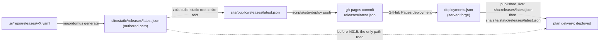

# 227. The deployed stage reads the pointer where Pages published it

## Context

ADR 0166 made an issue's delivery a fact read from objects, never a stamp: `deployed` is
proved when the release pointer (`latest.json`) that the newest successful Pages deployment
published names the issue's release or a later one. The reader took that pointer from
`<deployed sha>:site/static/releases/latest.json`, the path the pointer is *authored* at.

It never held. Since 2026-09-05 (40ab2fd62d8, f0623b631b4) every Pages deployment is a
commit that `scripts/site-deploy` pushes to `gh-pages` ("deploy: site from <sha>"), whose
tree is the built site: the static root is the site root, so the pointer is
`releases/latest.json`. The reader was written on 2026-10-16 (ee02079b1bc, I2740), six weeks
later, against the authored path, and failed on every deployment from its first day, saying
so only as `unread: publication`.

On 2026-10-28, at origin/master 81ef931a3e1, majordomus.dev served 81ef931a3e1 and `delivery
report` counted 29 of 29 features deployed and publicly verified, while `plan delivery` read
`deployed` for none of 1036 issues and left 208 at `released`. Nothing was red:

- the integration test committed the pointer at the source path, so it proved the reader
  against the layout the reader assumed, not the one the deploy produced;
- the Pages workflow's `ui-snapshot` job observed the forge (`served forge`) and published a
  delivery that read no publication, as an ordinary answer;
- since 3e8225a4329 (2026-10-13) deployments are observed only by `served forge`, which that
  job runs and no local reader does, so a checkout read "no deployment observed" first and
  the second cause stayed hidden behind the first.

## Decision

1. The reader reads the pointer at the path the site serves it first: the release
   directory with the static root removed (`releases/latest.json`, derived from
   `distribution::PUBLIC_DIR` and `distribution::release::PUBLIC_DIR`, never written as a
   second literal), and then at the authored path, for a deployment of a source commit.
   A commit that carries neither is unread, and the reason names both paths and the commit.
2. The test publishes the way the deploy does: a gh-pages commit outside the trunk's history
   whose tree is the built site. The source-commit layout and the commit that carries neither
   are tested beside it.
3. The `ui-snapshot` job of the Pages workflow, right after it observes the forge, asks
   `plan delivery` and fails when the `publication` source is unread for any reason other
   than "no successful deployment". The job that publishes the answer is the job that
   refuses a wrong one. When the forge could not be observed (`served forge` degraded,
   I4380), the stage is reported unknown with a warning and publication proceeds; an
   observed forge with an unread publication still fails the job.
4. Observing deployments stays its own command (`served forge`, 3e8225a4329): `prs refresh`
   does not ask for them again, because the cases whose forges do not answer that question
   are why it was separated. A local reader that wants `deployed` runs `served forge`; the
   unread reason says so.

## Alternatives rejected

- **Read the pointer from the live site over HTTP.** It answers what is served now, not what
  a recorded deployment published, and makes a plan read depend on the network; ADR 0166
  keeps live sources to recorded observations.
- **Read `served observe`'s record** (`.ai/local/state/served/observations.jsonl`). It
  proves that a deployment serves a commit, not which release pointer it publishes.
- **Push the source tree to gh-pages as well.** It would change what the site serves to fit
  a reader, and two copies of one pointer drift.
- **Fold `served forge` back into `prs refresh`.** Reverses 3e8225a4329 and breaks every
  case whose forge does not script deployments.

## Consequences

- At origin/master 81ef931a3e1, after `served forge`, the issues whose release v0.30.2 or an
  earlier stable release covers read `deployed`; the pointer names the newest stable release,
  so a pre-release (`v1.0.0-alpha.*`) is not `deployed` until it is the stable pointer.
- A future change of the publication layout fails the `ui-snapshot` job on the first
  deployment, in the run that published it, instead of reading `released` forever.
- `DeliveryDeployment.latest_json` names whichever path was read, so a reader sees which
  layout proved it.
- Related: ADR 0166 (delivery is inferred), I4315, the knowledge note
  `the-deployed-stage-read-a-path-nobody-published`.
