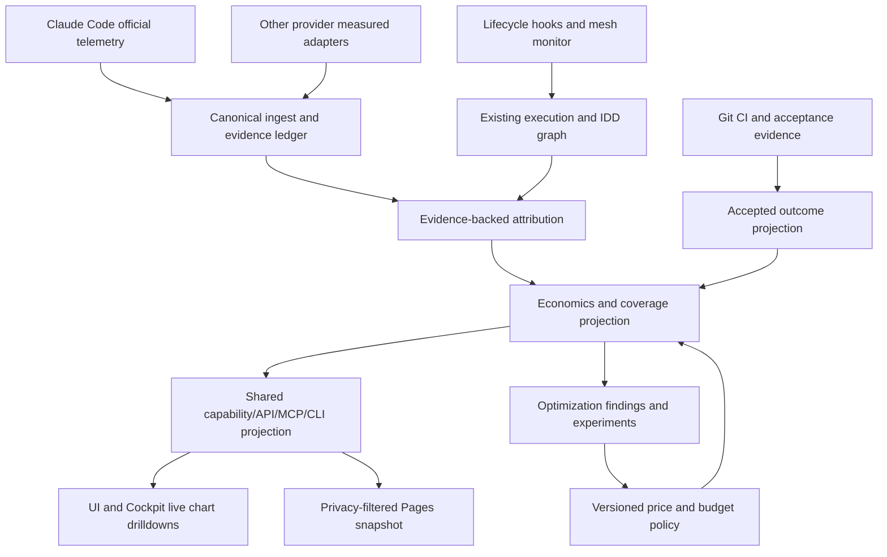

# Tokenomics architecture & cross-connections

### Critical architectural connections

- IDD execution graph provides causal work ownership, **not** token measurements.
- Mesh monitor events provide lifecycle context, **not** invoice authority.
- Git/CI/verification gates define accepted outcomes, **not** activity proxies.
- `.ai/repo` stores normative measurement and routing policy, **not** raw events.
- `.ai/local` is per-checkout and non-public; preserve its isolation.
- Canonical capability declaration generates transport contracts instead of adding manually synchronized schemas.
- Pages static exports cannot be genuinely live unless an authenticated backend is separately available and intentionally exposed. Mark snapshots as snapshots.
- Derived optimization needs interventional measurement and quality constraints to graduate from advisory to enforced.
