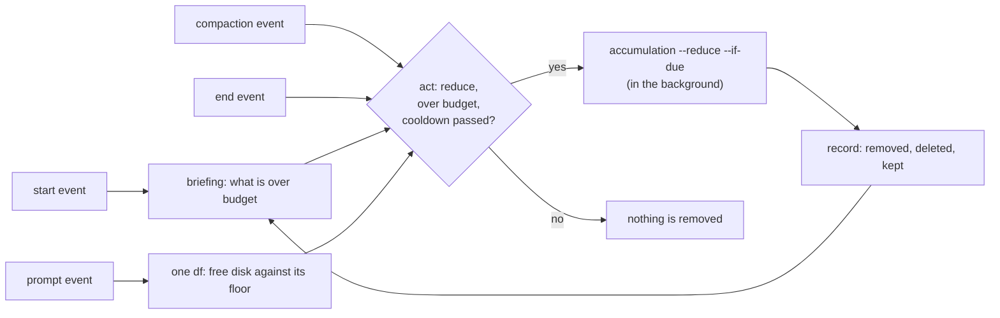

# The accumulation watch

A session's context is watched: the provider compacts before the window is full, and the
compaction event is where this tool records what would be lost. Worktrees, the names of
branches that have landed, and the disk under both grow the same way and had no such watch.
This is it (ADR 0150, rule `project.accumulation-is-watched`).

## For whom

- **A worker starting a session.** The briefing says what is over budget before the first
  tool call, so the first build does not find the volume full.
- **A person running several agents on one machine.** Spare worktrees and landed branch
  names are removed without anybody remembering to, when the policy consents.
- **A team adopting the tool.** The budgets are a block in the policy, and the default is
  to report and remove nothing.

## What is watched

| quantity | reading | budget key | over budget when |
|---|---|---|---|
| `worktrees` | the worktrees git registers, the primary checkout among them | `accumulation.worktrees_max` | more than the budget |
| `merged_branches` | local branches other than the trunk that the trunk, or the branch it follows, reaches | `accumulation.merged_branches_max` | more than the budget |
| `disk_free` | free space on the repository's volume, in MiB, as `df` reports it | `accumulation.disk_free_min_mb` | less than the budget |

A quantity with no declared budget is measured and reported as `unbudgeted`. A reading that
could not be taken is `unknown`, with the reason; it is never counted as within budget.

## When it reads



The four events are the provider's, wired by `majordomus capture install`. No daemon is
added and no interval is chosen: a repository nobody is working in is not accumulating
anything.

| event | what the watch does | cost |
|---|---|---|
| start | every quantity over its budget goes into the briefing, with what the policy allows; with `announce_on_mesh: true` the same is told to the mesh | one process, no subprocess per worktree |
| prompt | the free disk alone; one line when it is under its floor, at most once per cooldown | one `df` |
| compact | starts a reduction when the policy consents and one is due | detached |
| end | the same | detached |

## The policy

```yaml
accumulation:
  watch: true                # the episode events read the quantities
  act: report                # report | reduce
  worktrees_max: 20
  merged_branches_max: 20
  disk_free_min_mb: 2048
  cooldown_minutes: 30
  announce_on_mesh: false    # true: a crossed budget is an advisory claim on the mesh
```

`act: report` says what is over budget and names the command. `act: reduce` is the consent
to run it. A new repository gets `report`. A policy without the block watches nothing and
removes nothing.

## The commands

```bash
majordomus accumulation                    # every reading against its budget; exit 10 when one is crossed
majordomus accumulation --format json      # the same answer, typed
majordomus accumulation --brief            # only what a briefing carries; always exit 0
majordomus accumulation --headline         # only what a mesh claim carries: one line, or nothing
majordomus accumulation --reduce           # remove what is provably spare, when the policy says reduce
majordomus accumulation --reduce --if-due  # the same, at most once per cooldown: what an event runs
majordomus worktree cleanup --remove --branches   # the reduction itself, asked for by a person
```

The same answer is the MCP tool `majordomus_accumulation`, the MCP resource
`majordomus://accumulation` and `GET /api/v1/accumulation`.

## What a reduction removes, and what it keeps

A reduction is `majordomus worktree cleanup --remove --branches`. Every reading is taken
again at the moment of removal.

| candidate | goes when | kept when |
|---|---|---|
| the worktree of a landed branch | the branch has an upstream it is not ahead of, nothing has its working directory inside, and `git status` is empty | the branch is ahead of its remote, has no upstream or a deleted one; a process is inside; there is uncommitted work; `lsof` is missing |
| the name of a landed branch | nothing has it checked out and the trunk, or the branch the trunk follows, reaches its head | a worktree has it; it stands at the trunk's own tip; the trunk does not reach it; the ref moved since it was read |

A branch at the trunk's own tip is where new work starts, so it is kept: a branch created a
minute ago with nothing on it yet looks exactly like it. A name is deleted with
`git update-ref -d <ref> <head>`, which removes the ref only while it still points where it
was read. Nothing is lost when a name goes: every commit it pointed at is in the trunk.

Every candidate that is kept is printed with the reading that kept it. What a reduction did
is recorded under the primary checkout's local state, so all worktrees share one record and
one cooldown, and the next `majordomus accumulation` reports it.

## On the mesh

A full disk on one machine is every session's problem on that machine, and a session on
another machine may be about to offload a build onto it. With `announce_on_mesh: true` the
start event tells the mesh: the watch opens a session of its own, `accumulation-watch`, and
makes an advisory claim whose intent is the headline — for example
`accumulation over budget on lundra: worktrees 247 (at most 60); disk_free 48447 (at least 51200)`.
Every linked machine's monitor shows it (`majordomus monitor`, and the `Monitor:` line of
its briefings). When every budget holds again the session is closed and the claim ends on
every runtime. An advisory claim refuses nothing; it replaces the alert a session used to
write on the board by hand. A repository with no mesh says nothing and fails nothing.

## Switching it off

- `accumulation.watch: false`, or no block: the events read nothing.
- `accumulation.act: report`: the events say it and remove nothing.
- `MAJORDOMUS_ACCUMULATION=off` in the environment: off for that process tree. The test
  harness sets it, so no case sweeps the worktrees of the machine it runs on.

## What it does not do

- It does not remove the build output of a branch that is pushed and not yet merged. That is
  `scripts/reap-orphans` (`project.accumulation-is-measured`).
- It does not remove a worktree with uncommitted work, however old.
- It does not delete a remote branch.
- It does not refuse a build. The floor that does is `mj_rust_space_check` in
  `lib/rust_bin.sh` (ADR 0055); the watch speaks before that floor is reached.
- It does not watch a machine with no session open: the events are the only clock.

## Where it is

| what | where |
|---|---|
| the measurement and the verdict | `apps/majordomus-cli/src/accumulation.rs` |
| the capability | `apps/majordomus-cli/src/capability/builtin/accumulation.rs` |
| the command, the consent and the cooldown | `apps/majordomus-cli/src/commands/accumulation.rs` |
| the reduction and its refusals | `apps/majordomus-cli/src/commands/worktree.rs`, `apps/majordomus-cli/src/worktree/state.rs` |
| the events | `lib/capture.sh`, `lib/derive.sh`, `lib/rust_bin.sh` |
| the budgets | `.ai/repo/policy.yaml`, `share/skeleton/policy.yaml` |
| the proof | `test/cases/2986_accumulation_is_watched.sh` |
| the decision and the rule | ADR 150, `.ai/repo/rules/project/accumulation-is-watched.v1.md` |
