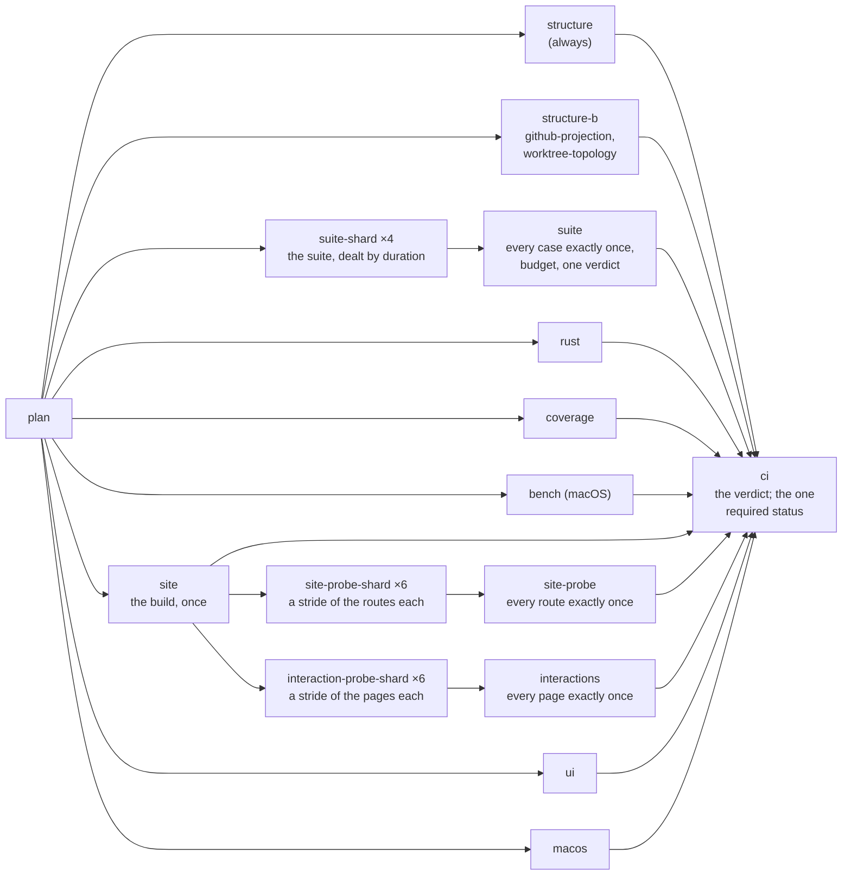
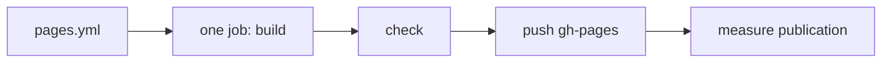

# Continuous integration

How a change is validated: one workflow that is an adapter over repository-owned tooling, a
planner that reads one model of what can affect what, gates that run in parallel and only
when a change can reach them, and one status a branch rule can require. Publication is not
here — [`GITHUB_PAGES_PERFORMANCE.md`](GITHUB_PAGES_PERFORMANCE.md) is the latency-sensitive
path that puts a master commit on GitHub Pages, and it runs beside this workflow rather than
after it. Every number about either lives in the measurements, never here:
`scripts/ci-baseline` records what GitHub observed into `.ai/repo/ci/baseline.json`, and
every run writes its own summary.

## The shape



and beside it, on the same commit, never after it:



`plan` reads the model and decides. `structure` runs the cheap, deterministic gates every
plan has (`scripts/ci/shell-lint`, `scripts/ci/core-check`) and the structural gates the
change needs. `structure-b` runs, beside it, the two structure gates that need not share its
55-minute bound: `github-projection`, which waits on GitHub's API, and `worktree-topology`
(I4381). With them in one job a full plan summed p50 2720 / p90 3256 s of gates, and run
40813274272 was killed at the bound with all 59 green, so no receipt reached the verdict. The
other jobs run when the plan selected a gate they carry, in parallel, each through the script
a person runs. `ci` always runs and turns the plan and the jobs' results
into one verdict.

A job does not list its gates. `scripts/ci/run-plan --plan plan.json --job <job>` reads the plan and runs every
gate the model assigns to that job, in the model's order, skipping the ones the plan did not
select; a job that runs one gate in a step of its own — the rust job's `rust-check`, which
needs a mode and an artifact argument — says so beside that step with `--skip`. The
alternative was tried and failed silently: four gates the model assigned to `structure` were
reported as "run" in every plan summary and executed by nothing, because the job's steps
were written by hand. A gate declared in `.ai/repo/ci/gates.yaml` now runs or is named as
skipped, and nothing in between.

Two workflows, and the split between them is what each decides. `.github/workflows/validate.yml`
decides whether a change may merge. `.github/workflows/pages.yml` decides what the public site
shows: it triggers directly on a master push whose paths can change the site and publishes as
soon as the bytes are proved, without waiting for gates that cannot change a published byte.
Neither repeats the other's work.

A third decides what GitHub's issues and milestones show. `.github/workflows/github.yml` runs
on every push to master, with no path filter: it builds the executable, asks
`scripts/github-sync --check` what GitHub does not show yet, runs `scripts/github-sync --apply`
when something is owed and the checkout is still the tip of master, and then runs
`scripts/ci/github-check`, the same `github-projection` gate validate runs. It holds
`issues: write` and `contents: read`, one run at a time and never cancelled, and every step
refuses to run without `MAJORDOMUS_BIN`. Its model is `.ai/repo/ci/github.yaml`, the rule is
`project.the-projection-is-applied-at-landing`, and
`test/cases/1097_the_projection_is_applied_at_landing.sh` holds the workflow to the model and
runs its steps against a scripted adapter. The gate in validate stays what it was: it bounds
how late the trunk may be when that workflow fails, and names the manual apply as the remedy.

A fourth keeps each pull request's metadata current. `.github/workflows/pr-meta.yml` runs on
every `pull_request_target` event that can change what a pull request serves or carries
(opened, edited, synchronize, labeled) and applies `scripts/github-sync --prs --pr <number>`
to that one pull request, and once a day (or on a dispatch) to every open one. What it
writes: the type, priority, `train` and `records` labels, the milestone, the author as
assignee when nobody is, and the `Refs #<n>` region of the body (`docs/PLANNING.md`, "Pull
requests"). Its token's writes start no other workflow, so the labels it adds start no
validate run. It checks out the default branch and never the head, whose commits and records
it reads with git as data, so `pull_request_target`'s writing token never runs a head's
code; it holds `pull-requests: write`, `issues: read` and `contents: read`, runs one at a
time per pull request (and one sweep at a time) and is never cancelled. It is the one run a
pull request may start (`project.the-projection-is-applied-at-landing@2`). Its model is
`.ai/repo/ci/pr-meta.yaml`; `test/cases/1097_the_projection_is_applied_at_landing.sh` holds
it to the rule and `test/cases/3970_a_pull_request_carries_its_metadata.sh` to its model,
and drives the adapter against a scripted forge.

## The model: what can affect what

`.ai/repo/ci/gates.yaml` is the one place the dependency map lives. It declares the gates
(each with the job that carries it and the command it runs) and the path classes: a
pattern set and the gates a change under it can affect. `scripts/ci-plan` reads it and
nothing else; the workflow carries no path list of its own. The rules the planner applies
are written at the top of the model. In short: the always gates run in every plan; a
changed path selects the gates of every class it matches, as a union; a class may escalate
the whole plan; a path no class knows escalates it too, and the plan names the path; a
gate brings what it implies and what it requires.

```bash
scripts/ci-plan --check                       # the model resolves: every gate, job and reference
scripts/ci-plan --format text                 # what CI would run for the working tree against master
scripts/ci-plan --base origin/master --head HEAD
printf 'docs/DESIGN.md\n' | scripts/ci-plan --files - --format text
scripts/ci-plan --full "why" | jq .selected   # the full plan
```

Two execution classes, both evidence-driven:

- **affected** — a pull request: the gates of the classes its changed paths fall in. Nothing
  is skipped on a hope; a gate is left out only when no changed path is in a class that
  names it, and the plan says so for every gate.
- **full** — every gate but the on-demand ones: a push to master, the nightly schedule, a
  manual dispatch, a pull request labelled `ci:full`, a change to the pipeline itself (the
  workflow, the actions, `scripts/ci/`, the planner, the model, the runner), or a path the
  model does not know. The pipeline's own data files under `.ai/repo/ci/` — the shard
  durations, the case-number and GitHub-drift ratchets, the recorded baseline, the
  directory's README — are not the pipeline: the `ci` class names each one in `except`, one
  path at a time, and the `ci-data` class plans the gates that read it. A file that appears
  under `.ai/repo/ci/` without being named still escalates.

A third distinction cuts across both. A gate the model marks `on-demand: true` is planned
only when the plan is asked for it (`scripts/ci-plan --on-demand`), which the nightly
schedule, a dispatch and a `ci:full` pull request do and a routine push does not. Three
gates carry it — `macos`, `rust-bench` and `installer-live` — and what they share is a macOS
runner rather than a subject. The reason is arithmetic, and the model states it: this
repository pushes to master about every seven minutes, the macOS suite runs for about 106
minutes, and three macOS jobs per push is demand no shared runner pool answers. On
2026-09-10 four master runs had every Linux job finished — five of them red — while their
`ci` job had not started, because it needs those three and they had been queued for hours;
master carried the defects overnight with every check apparently green, because a run that
never reported and a run that reported green look identical in the interface. The gates were
not weakened: they run in full every night and on request, which is more often than they
were completing. `ci` still needs their jobs and still turns red when one of them does.

A fourth cuts across all of them, and it is the one distinction that takes a gate out of CI
planning altogether. A gate the model marks `at-finish: true` measures a **deployment**
rather than a tree: which commit GitHub Pages is serving, whether that commit is still on
master, whether anything has landed since. No edit to any file can make that question come
out differently, so no path class can select it — and being in no class is not the defect
here that it was for `version-surface`, it is the honest consequence of what the gate
measures. `pages-live` carries it.

Which leaves the question owned by nobody. A full plan does ask it, and a full plan runs on
a push to master — *before* the publication it would judge. The moment it is worth asking is
when a worker says the work is done, so that is who asks: `majordomus finish` runs every
`at-finish` gate live and refuses the outcome `completed` while one of them reports the
published site is behind the trunk. The doctrine is `majordomus.publication-currency` and
the repository turns it on with `publication_current` in `verification.finish_requires`; a
gate that could not reach its subject — no network, no published branch — is reported
unverified by name, with its exit, and refuses `completed` as well: a session that could not
measure the site is not evidence that it is stale, but it is no evidence that it is current
either, which is what `completed` claims. `partial` and `blocked` are never refused over it.

To force full validation of a pull request, add the label `ci:full`; the `labeled` event
re-plans it. To see why a gate ran or did not, read the `plan` job's summary or the
`ci-plan` artifact, or run the planner on the same diff locally.

`test/cases/94_ci_plan.sh` proves the relationships that matter: a Rust change selects the
Rust gates and never the site, a site change the site gates and never a Rust gate, a
document the site and the registry checks, the distribution every implementation, the
pipeline and an unknown path the full plan, an inert path only the always gates; and that
the model refuses a dangling reference. `test/cases/26_ci_wiring.sh` proves the workflow
is an adapter over the model: every gate's job exists, is gated on the plan's output for
that gate, is needed by `ci`, and `ci` always runs.

## The gates

The list, with the command each one runs, is the model: `scripts/ci-plan --full x --format
text` prints it, and `.ai/repo/ci/gates.yaml` explains each. The commands are the ones a
person runs:

```bash
scripts/ci/run-plan --job structure --plan plan.json   # one job's gates of a written plan, as CI runs them
scripts/ci/shell-lint                  # syntax and shellcheck over the tool, the scripts, the cases;
                                      # shellcheck in batches over MJ_LINT_JOBS workers (the CPUs)
scripts/ci/core-check                  # doctor, watch, context, continuity, plan validate, github-sync, references, site data
scripts/ci/providers-check             # one provider declaration, every projection current, no provider list by hand
scripts/ci/worktree-check              # one constant, the guard wired, every document naming the same container
MJ_TEST_JOBS=4 bash test/run.sh        # the behavioural suite, four cases at a time
scripts/rust-check --ci                # every Rust gate but coverage; the benchmark comparison is macOS's
scripts/rust-check --integration       # the executable built and the registry checks only
just coverage                          # coverage with test code out of the denominator, against
                                      # scripts/rust-coverage-threshold and, for the session/continuity
                                      # domain, scripts/session-coverage-threshold
scripts/site-build && scripts/site-check
SITE_PROBE_JOBS=4 scripts/site-probe   # every route at three widths, four routes at a time
```

`just ci-plan`, `just ci-structure`, `just ci-fast` and `just ci-full` are the recipes.

## The suite in parallel

`test/run.sh` runs the cases through a bounded pool when `MJ_TEST_JOBS` is set: that many
at a time, each with its own log, then the cases that declare `# majordomus-exclusive:
<reason>` one at a time, and the verdicts rendered in name order at the end with a failing
case's whole log before its line. Without `MJ_TEST_JOBS` it runs serially, streaming, as
it always has. The semantics are the serial runner's: a failing case turns the run red, a
filter that matches nothing is a usage error, an empty case directory is a usage error, and
`MJ_TEST_REPORT` writes one row per case (name, result, seconds, phase) for the summary.

## The crate's tests in lanes

The `rust` job is a matrix of three lanes. `scripts/rust-check` deals `cargo test` by whole
test binaries (`MJ_RUST_TEST_LANE`), using their measured seconds:

1. the doctests and `preflight`;
2. the lib's unit tests, the binaries, `cli_examples`, `bench` and `peer_claims`;
3. every other test binary, so a new one lands there by itself, and every other gate: fmt,
   clippy, the docs, the benchmark build, the registry checks, the plan's rust gates and the
   executable artifact.

`scripts/rust-check --lanes` prints the deal. With `MJ_RUST_TEST_LANE` unset, `rust-check`
runs the whole `cargo test` as before. Each lane keeps its own `cargo-test-<lane>.txt`, and
the `evidence` job joins them. Every binary's record starts at a `Running` line or a
`Doc-tests` line, which the recorder treats as a boundary, so joining the files cannot credit
one lane's result to another lane's binary.

## The suite in shards

On CI the suite runs as four shards on four runners (`suite-shard`, a matrix), each four
cases at a time. `MJ_TEST_SHARD=i/n` makes `test/run.sh` run the i-th part. The cases are
dealt longest-first over n × `MJ_TEST_JOBS` worker slots by the seconds
`.ai/repo/ci/suite-durations.tsv` records, and then the exclusive cases go to the
least-loaded shard. Slot s belongs to shard s mod n, so the heaviest cases open one per
shard. In the first run the slots were numbered shard by shard, the four 35-minute cases
landed on one runner and starved each other past the 3630 s timeout, and case 721 now
refuses that deal. A case with no recorded seconds weighs 300 s. The file is committed, so
every shard of a run deals the same hand: stale numbers only unbalance the shards, they
never lose a case. Measured on one runner the suite took more than two hours, because
24,879 case-seconds were dealt to four workers. Dealt to sixteen workers, the critical path
is the longest single case, about 35 minutes.

Sharding can lose a case or run one twice, and either looks like a quieter or a slower
suite rather than a wrong one. So the `suite` job does not run cases. It joins the shards'
reports and runs `test/run.sh --verify-report`, which fails unless every case under
`test/cases/` has exactly one row. It holds `scripts/ci/suite-budget` against the whole run,
publishes the joined report as `ci-metrics-suite`, and fails when any shard failed. Case 721
proves the deal and the verification. `MJ_TEST_LIST=1` prints what an invocation would run.

To rebalance, record the seconds of a recent green run (the `ci-metrics-suite` artifact):

```console
$ gh run download <run-id> -n ci-metrics-suite -D /tmp/s
$ awk -F'\t' -v OFS='\t' '{print $1, $3}' /tmp/s/suite.tsv | LC_ALL=C sort > .ai/repo/ci/suite-durations.tsv
```

The jobs that run the suite check out the whole history: a case that clones the checkout
into a fixture and pushes cannot push a shallow clone. So does the `rust` job, for the
other reason: `generate --check` runs there, and the changelog it checks is composed from
the release records, the decisions and `git log <previous>..<this>`. A checkout one commit
deep has none of that history, so every release record names a commit the clone does not
have, the composer writes the degraded document
`project.release-is-a-projection` requires of it, and the gate reports the committed
artifact stale for a reason no branch caused. A gate reads its inputs; the job fetches
them. A case may read the checkout it
lives in but must not write into it while other cases run;
the parallel phase checks `git status` before and after and fails naming the paths when
something changed. The cases that must write there (the two that build the site into
`site/public`, the one that edits and regenerates a derived document) carry the exclusive
header. A case never runs outside the fixture the runner made for it: every case writes
into the directory it starts in, and started by hand from a checkout it would write its
fixture there. So `test/lib.sh`, which every case sources first, refuses with `run this
case through test/run.sh` unless `$T` and `$ROOT` are set, the case stands in `$T`, and
`$T` is neither the checkout, nor inside it, nor another checkout of this repository. The
Rust cases drive the executable `MAJORDOMUS_BIN` names when it is set (CI
builds it once per job and hands it to every case), and build it once through cargo
otherwise; the two whose assertions are cargo's own (the crate's HTTP and projection suites,
the doc examples, the benchmark build) keep cargo.

## The browser probe

`scripts/site-probe` measures one route per browser process: the three widths are three
iframes of that route side by side in one page, each measured by the same script as
before (viewport against scroll width, the elements and text runs past the right edge, the
diagrams rendered against the diagrams declared). `SITE_PROBE_JOBS` bounds how many routes
are measured at a time; the findings are rendered in route order whatever the order the
processes finished in, and a finding still names the route, the width, the assertion and
what was measured. The homepage behaviour checks (the mobile menu, the dropdown, the theme
toggle) are unchanged. `--quick` remains the local sample.

In CI the sweep is split in six (I2841). As one step of the site job it took 35-37 minutes,
which held that job at 46-50 of its 50 minutes until one run was cancelled at its bound. The
Czech copies then doubled the routes, and run 39317142394 stopped the single step at its
2700 s bound. The `site-probe-shard` jobs now run side by side after the site job's build:

- each one gets the files that build generated and git ignores (artifact `site-probe-inputs`);
- each runs its own Zola build;
- each measures `SITE_PROBE_SHARD=K/6`: every sixth route of the sorted list, starting from
  the Kth. A stride rather than six blocks, so the expensive sections are spread across shards;
- each writes the routes it measured (`SITE_PROBE_REPORT`).

The homepage behaviour and the command routes are shard 1's, so each is reported once.

The `site-probe` job is the gate's. It asks `scripts/site-probe --verify-report` whether the
reports are shards 1..6, each once, and whether together they hold every route of the site,
each once. Only then, and only if every shard passed, does it write the gate's receipt.

Case 3602 holds the partition, the fan-in and the wiring, whatever the number of shards.
Reproduce one shard locally with `SITE_PROBE_SHARD=2/6 SITE_PROBE_JOBS=4 scripts/site-probe`, or
see which routes it holds with `scripts/site-probe --partition 2/6 < routes.txt`.

## The interaction probe

`scripts/interaction-probe` drives every control on every page with the behaviour spec that
claims it (`project.every-link-and-control-is-tested`). As one job it rebuilt the site and drove
every page in one step. That step reached page 1850 of 1865 at its 2400 s bound on 2026-10-12.
After the Czech copies doubled the pages, run 39317142394 stopped it at 3300 s.

Since I3602 it is split in six like the site probe, and cut by the same rule:

- the site job packs its build without the composed surfaces (artifact `interaction-probe-site`,
  about 26 MB; the mounts come from the topology);
- each `interaction-probe-shard` job drives `MJ_PROBE_SHARD=K/6`, the stride
  `scripts/site-probe --partition K/6` gives for the sorted pages, and writes them to
  `MJ_PROBE_REPORT`;
- the `interactions` job keeps the gate. It runs `scripts/site-probe --verify-report` over the
  six reports and writes the receipt only if they are every page once and every shard passed.

No page is sampled, the Czech copies included. A finding still fails the shard that drove the
page and names the page and the spec. Case 3603 drives three shards of a fixture site in a
browser. Reproduce one CI shard with `MJ_PROBE_SHARD=2/6 MJ_PROBE_JOBS=4 scripts/interaction-probe`.

## Where the jobs run

The plan job decides, once, the runner of the first wave, and each first-wave job reads it
as `fromJSON(needs.plan.outputs.runner || '"ubuntu-latest"')` (I4242). The first wave is
the jobs that run once beside the critical path (plan, build, the suite and ui shards, suite,
evidence, ci) or are its cheap unions: suite, coverage, evidence, site-probe,
interactions, ui, cockpit, mesh-lab, pages and ci. Everything else stays on `ubuntu-latest`,
structure among them (its gates took 3214 s on lundra-3 against 36-48 minutes hosted, past
the job's 55-minute bound, run 40613243708):
three runners of one machine serialise a full run's thirty jobs into hours (run
40407809503), while GitHub-hosted runners take the shards twenty at once. The pool is the
repository's own machines: the repository variable `MJ_RUNNER` names them, as a
runner label (`lundra`, meaning `[self-hosted, lundra]`) or a JSON list of labels. They cost
nothing per minute and do not share the account's hosted concurrency, which sixteen
validate runs exhausted on 2026-10-26.

| event | runner |
|---|---|
| push, schedule, a pull request from a branch of this repository | `MJ_RUNNER`, else `ubuntu-latest` |
| a dispatch | its `runner` input, else `MJ_RUNNER`, else `ubuntu-latest` |
| a pull request from a fork | `ubuntu-latest`, whatever `MJ_RUNNER` says: the repository is public and the pool is machines of the fleet |
| the plan job itself; macOS and the install matrix | as written: the plan stays hosted so a verdict is planned while the pool is offline |

The plan's fork rule is routing, not the security control. A fork's `pull_request` run
executes the workflow file of the pull request, so its author could name
`[self-hosted, lundra]` directly. What keeps a stranger's code off the fleet is the
repository's fork setting, `approval_policy: all_external_contributors` (read it with
`gh api repos/{owner}/{repo}/actions/permissions/fork-pr-contributor-approval`): no outside
contributor's run starts until the owner approves it, and a fork run that changes
`.github/workflows/` is never approved. A user-owned repository has no runner groups; if
that changes, restrict the pool's group to this repository's push and same-repository
events.

An offline pool queues jobs rather than failing them, so the remedy is
`gh variable delete MJ_RUNNER`: the next run is hosted, with no other change. A pool is
proved on a branch first with `gh workflow run validate.yml --ref <branch> -f runner=lundra`.
`pages.yml` and `release.yml` hold deploy and release credentials and stay hosted. A
GitHub-hosted image carries Node and the pool need not, so every first-wave job sets Node up
on a self-hosted runner: `setup-site`, or `actions/setup-node` guarded by
`runner.environment == 'self-hosted'` (structure, then of the first wave, failed on lundra
without it, run 40416931397). Case 4242 holds every job to the planned runner and to that Node, and drives
the plan's runner step with a fork's event.

## Caches and artifacts

Caches hold reusable dependency and build state; artifacts carry a job's outputs to a
later job or a later phase. Jobs run on isolated runners, so nothing relies on a shared
filesystem.

| cache | holds | key | invalidation | scope |
|---|---|---|---|---|
| npm (`actions/setup-node`) | the npm cache for `npm ci` | OS, `package-lock.json` hash | the lock file changes | restored from master when a branch has none |
| Rust (`Swatinem/rust-cache`, `.github/actions/setup-rust`) | the cargo registry, the git checkouts of dependencies, `target/` | job, OS, toolchain, `Cargo.lock` | the lock file or the toolchain changes; a red job saves nothing | per job, restored from master when a branch has none |

Nothing else is cached: Zola is one download, shellcheck one package, Chrome is on the
runner image. What a cache holds is never a source of truth: every gate reads the checkout.

| artifact | from | for | retention |
|---|---|---|---|
| `ci-plan` | `plan` | the verdict, a person asking why | short |
| `majordomus-cli-<target>` | `rust` | any later job or phase that needs the executable without building it: the debug binary and `majordomus-cli.json` (commit, target triple, rustc, `Cargo.lock` digest, profile) | short |
| `ci-metrics-<job>`, `ci-performance-metrics` | every job, `ci` | the timing rows of a run, gathered | longer |

## The Rust executable as a build output

`scripts/rust-check --artifact DIR` copies the debug executable into `DIR` with its
metadata beside it, and the `rust` job publishes that directory as
`majordomus-cli-<target>`. A consumer downloads it and sets `MAJORDOMUS_BIN`: the launcher
`bin/majordomus-mcp`, the suite and every Rust case honour that variable and never build
when it is set. Within one run the suite does not wait for the `rust` job: measured, the
suite job's own build from a warm cache costs seconds while waiting for the `rust` job
would serialise minutes, so the two run side by side and the artifact serves the phases
that come after a run (a release, a scenario runner over the real binary). Release builds
belong to a release workflow; every gate here uses the debug profile, which is what the
cases and the crate's own suites drive.

## Pages

Publication has its own workflow and its own document,
[`GITHUB_PAGES_PERFORMANCE.md`](GITHUB_PAGES_PERFORMANCE.md). What matters here is the
boundary: this workflow's `site` job builds, checks and probes the site as a gate on merging,
and publishes nothing; `pages.yml` builds and checks the same commit again — cheaply, without
the probe and without a generation — and publishes. The duplication is deliberate and small:
the publication path cannot depend on a job it does not wait for, and what it repeats costs
seconds.

Concurrency: a pull request's runs here are superseded by its next commit; every other run of
this workflow is its own group and neither waits for nor cancels another, so a run held up by
a scarce runner does not hold up the next commit's evidence. Deployments are serialised —
`pages.yml` runs one deployment at a time and never cancels the one in flight; GitHub keeps only
the newest pending run of the group, so a burst of merges costs at most one extra deploy of an
intermediate commit, and an older tree can never land after a newer one. Cancelling the run in
flight starved publication on 2026-09-12: each superseding run was itself superseded, and the
site stood 34 commits behind master for three hours.

A pull request's run ends at its first red. Once one job has failed the run cannot be green,
and the jobs still going hold runners the trunk's run and the deployments wait for: on
2026-10-13 a run with two failed jobs kept nine more running for twenty minutes. So the last
step of every gate job of `validate.yml`, on `failure()` of a `pull_request` event alone,
cancels the run by its own id with the job's token (`actions: write`); `ci` and `evidence`
still run, because they run `always()`, and report the run red. A combined top, a pull request
whose head is an `integration/*` branch, is never cancelled this way: it carries many heads and
is judged once for all of them, so one run of it shows every red (on 2026-10-15 the grand top
took three full cycles to show three reds). A push to master, the schedule
and a dispatch are never cancelled this way: the trunk's remaining jobs are the only reading of
its other lanes. Read a failed job's log through the jobs API (`gh run view --job <id> --log`)
rather than waiting for the run. Case 3019 holds every job to it (I2664).

A cancel GitHub accepted is a request, not an end. On 2026-10-19 a cancelled run's `suite` job
went on running and held its slot in the pool; only
`gh api -X POST repos/<owner>/<repo>/actions/runs/<id>/force-cancel` freed it. So after a cancel,
read the run again (`gh run view <id> --json status,jobs`): one that has not completed a minute
later, a job of it still `in_progress`, is force-cancelled. `scripts/ci/release-path preempt`
does this by itself for the runs it cancels, after the model's `cancel_wait_seconds`; case 3027
holds it.

The release path goes first (I2710). Every workflow of this repository draws on one pool of
job slots, first come, first served, and on 2026-10-14 v0.26.0 was published while its record's
verdict and the Pages deploy that publishes it sat queued behind two pull requests' validates
holding all twenty slots; the site offered the previous release until a person cancelled one
of them by hand. The release path is three kinds of run, read from what GitHub lists rather
than from the release workflow: a run of `release.yml`, the validate run on a
`release/record-<tag>` branch (the early reading the release dispatches, and the record pull
request's own run once a person starts it), and a `pages.yml` run of master that the
release's token dispatched. While any of them is queued or running:

- a pull request's validate yields at the first step of its plan job, before any job of its
  own asks for a runner: it labels its pull request `ci:yielded`, comments which run it yielded
  to, and cancels itself;
- a tag push preempts: `.github/workflows/release-path.yml` starts on the same push as the
  release and cancels every pull-request validate already queued or running, labelling and
  telling each the same way, and force-cancels any of them that still runs after the wait;
- once the path is clear, `scripts/ci/release-path resume` re-runs the newest validate run of
  each labelled pull request's head when that run is the cancelled one, and removes the label.
  It is asked at the end of every validate run that is not a pull request's (the record's
  verdict is one) and every fifteen minutes by `release-path.yml`'s schedule.

Never cancelled by this: anything of the release path, master's validate, the schedule and a
dispatch, a run on a record branch, and a run whose pull request GitHub does not name. A
reading that cannot be made lets a run proceed and touches nothing. The model is
`.ai/repo/ci/release-path.yaml`; case 3027 holds the decisions and the wiring.

The `pages` job judges the site only after the deployment of its own commit (I2711). It starts
minutes after the push that also starts that commit's deploy, and on 2026-10-14 run
38600347235 read the site while the deploy was in flight and went red; a rerun passed.
`scripts/ci/pages-check --for "$GITHUB_SHA"` first waits, bounded by `PAGES_CHECK_DEPLOY_WAIT`
(twenty minutes) and asking every `PAGES_CHECK_POLL` seconds (thirty) with a line each time,
until production serves that commit or one that carries it — a newer trunk commit, or an older
one when nothing since changed what the site is built from. It refuses early only when
production serves an older commit and no deployment is in flight (no pages run queued or
running, GitHub's own build not building), and otherwise at the bound, naming both commits. A
pull request's merge commit is not on master and is not waited for. The job's bound is 35
minutes to hold the wait and the checks after it; case 3028 holds the wait.

### The three ways a deploy fails, and who reports each

A deploy that does not put the intended commit in front of a reader has failed, and until
2026-09-11 the three ways that happens were reported with three different volumes.

**The build refuses.** `scripts/pages build` establishes the committed derived data is current
by fingerprint before rendering it, and refuses a stale tree. The run goes red and the
`publication state` step writes `::error title=Not published` on it. This is the loud one, and
it is also by far the most frequent: both failures of 2026-09-11 (runs 34549001300 and
34550274563, the merges of #202 and #203) were this, and both merge parents were already stale
before the merge — the pull request's own `site` gate had been red and the merge happened
anyway, because `master` has no required status check.

**The run is cancelled.** Nothing in the group cancels a deployment in flight, but a run can
still end `cancelled` — a pending run dropped for a newer one, or a job killed by its own bound —
and a cancelled run is not a failure; `gh run list` says `cancelled` whether gh-pages was pushed
or not. A pending run is only ever dropped for a newer run of a newer commit, so the chain
always ends in a run that publishes or one that goes red — a cancelled run cannot be made red
from inside, so what acts on it is `pages-live` on the next validation of master.

**GitHub's own build errors.** This was the silent one. Publishing is two steps and the second
is GitHub's: `pages build and deployment` turns the pushed branch into the served bytes, and it
can error on a branch that was pushed perfectly. On 2026-09-10 at 17:35:10Z it errored on
gh-pages commit `dfd9c989c` with *Page build failed.*; the push had succeeded, the branch was
right, the workflow reported success, and the site served the previous commit for 27 minutes
with nothing red anywhere. The publication probe above it is `continue-on-error` on purpose —
it waits on a queue, a build and a CDN that this repository does not own, and a gate on
somebody else's latency is a gate that gets waived — but *slow* and *failed* are different
facts and the second one has an API. `scripts/pages built` reads it, in one place, for both
callers: `pages.yml` fails the run on an errored build at the moment it happens, and
`scripts/ci/pages-check` asks the same question afterwards through the same command. Only
`errored` is a failure (exit 10). A build that has not finished, one of another commit, or one
that could not be read at all is a note and exit 12, not determined: never a failure, and never
the pass it used to be, when the gate printed the whole guarantee over the half it had not seen.

## Where a gate cannot reach

A gate that never fires is worse than one that fails, because the verdict still reads
complete. Three ways that happens here, all measured on 2026-09-10 rather than reasoned
about, and each of them cost a real outage or a real afternoon.

**The staleness catch cannot run on the path most merges take** — the driver resolving to
ours is a design decision working correctly, and the defect is that the only thing checking
its result runs in a `pre-commit` hook, while no hook of any kind runs for a merge the server
creates. `.gitattributes` sends
derived artifacts to `scripts/merge-derived`, which resolves them to *ours* and exits clean.
That is deliberate: a derived file carries a fingerprint of the tree it was generated from,
so after a merge neither side's value is right and the answer comes from running the
generator, not from a conflict marker. The design leans on `scripts/pages current` in
`.githooks/pre-commit` to refuse the stale result one command later — and **a `pre-commit`
hook cannot run for a merge the server creates.** Merging a pull request on GitHub produces a
commit with `committer=GitHub`, and no client-side hook exists on that path. It is not a
bypass; it is the action this repository tells people to take. On 2026-09-10 there was no
branch protection (`gh api repos/<owner>/<repo>/branches/master/protection` answered *404
Branch not protected*), so nothing server-side compensated, and the `site` gate that checks
currency was advisory and reported after the merge. The first thing in the pipeline that could
refuse was the Pages build, and it refused by failing publication rather than by failing a
pull request. The symptom was always "the site is stale" and never "the branch is red".

What guards that path now (I1409, ADR 0101 amendment of 2026-10-15) is the ci-time freshness
gate, and the hook plays no part in it. The `ci` check is required (`strict: false`). It runs
`derived site data in sync` and `generate --check` on the pull request's merge ref. The forge
runs no merge driver, so two branches that both changed a canonical input conflict on
`source_hash` and cannot be merged by the forge at all. The merged commit is checked again on
push, and `scripts/pages build` refuses stale site data before the `publish` step. The
pre-commit hook guards only a merge a person commits.

The vivid form: a stale recording rides through a merge untouched, so two consecutive master
merges can carry the *same* `source_hash` — nothing regenerated between them. A guard whose
coverage is inverse to its usage is worse than a missing one, because nobody notices it is
absent.

The condition above was observed on 2026-09-10 and then repaired, and the gap it illustrates
is structural rather than a description of how the trunk stands today — so do not test this
by looking at the trunk and concluding the finding expired. The commits carry their own
evidence permanently: `git show <commit>:site/data/generated/source.json` beside
`scripts/pages fingerprint` on that tree, and `git log -1 --format=%cn` for who committed the
merge.

**A check whose input goes empty can vanish instead of failing.** `scripts/site-check`
derives `PREFIX` by stripping scheme and host from `base_url`. At an apex domain the path
component is empty, and the block that uses it is guarded by `if [ -n "$PREFIX" ]` with no
`else` — so it emits neither `ok` nor `bad`. The verdict still reads complete. Note that
simply removing the guard is wrong: the filter it protects would then match everything its
own first stage can emit and print a green `ok` over an empty set. What an empty prefix needs
is a *different* predicate, not the same one ungated.

The tool has vocabulary for this and the doctrine gates use it: `mj_doctrine_skip` prints the
check, says it did not run, and gives the reason — see the blocker and scope gates in
`lib/check.sh`. A gate with only `ok` and `bad` makes silence the path of least resistance
every time an author meets a case they cannot decide.

**Two queries worth running against any new gate.** The first is this document's; the second
came out of the apex case above:

- for every field a validator reads out of a state record, can something write it?
- for every value a check derives, is empty distinguishable from absent?

The first has a mechanical form — `grep` the readers and the writers — and it found that a
task's `requires` had five readers and no writer at all, so `check` reported "the task
declares no obligations" truthfully and forever. In each case the rule existed, the validator
ran, and its answer was *true about the half it could see*.

**One correction for whoever proposes the obvious repair.** The natural fix for stale derived
data is to let the Pages build re-derive rather than refuse. It does not work, and the reason
must be stated precisely or it is refutable in one command. The **input fingerprint is
deterministic** — `scripts/pages fingerprint` three times on one tree gives one value. What is
machine-dependent is the **generated content**: `%h` abbreviates against the local object
store, a depth-1 checkout writes a degraded changelog, a concurrent derive can read a sibling
worktree root. A build that re-derived could therefore publish a third answer matching neither
side. State it as content-dependence, never as fingerprint non-determinism.

One thing the generation guard is not: the digest it compares is taken over `Cargo.toml`,
`Cargo.lock`, `build.rs` and `src` only, with `benches/` and `tests/` deliberately outside
it — which is why a branch that changes no Rust may legitimately use a binary built in
another worktree.

**A note about the plan.** `majordomus plan validate` refuses an issue that names no
milestone. So an area of standing work with no milestone is not merely unfiled — the work in
it cannot be recorded in the plan at all, which is how a repository can land a great deal of
change against a plan that never moves. If a gate finds something worth an issue and no
milestone fits, the milestone is the missing part; do not park the issue under the
least-wrong parent, because status here is derived from the graph and a false parent
propagates into the roadmap and the waves.

## Platforms

Linux is the blocking path for everything that does not depend on the platform: lints,
documentation, coverage, the benchmark runner. macOS runs what does: the behavioural suite
under the stock macOS shell (bash 3.2) and BSD userland, and the crate's own suites there
(files, signals, the lease, the spawned processes). The benchmark check against a committed
baseline runs on macOS, the one platform with a baseline under `.ai/repo/benchmarks/rust/`.
`docs/HARDCODING_LEDGER.yaml` records the platform list as a deliberate decision.

The macOS gates are the on-demand ones (above): the nightly schedule, a dispatch and a
`ci:full` pull request plan them, a routine push does not, because a macOS runner is what
this repository waits hours for and a gate queued behind one reports nothing at all. A
change that is likely to be platform-dependent — the shell tool, the distribution, the
crate's process and file handling — should carry the `ci:full` label rather than wait for
the night, and that is a judgement a reviewer makes, not one the model can.

## Telemetry and budgets

Every job writes a summary (`scripts/ci/summary`): the plan's selection, the cache hits,
the durations of its gates and steps (`MJ_CI_TIMINGS`, `scripts/ci/timed`), the slowest
cases of the suite (`MJ_TEST_REPORT`), the artifact it produced. The `ci` job gathers the
rows of every job into `ci-performance-metrics`. `scripts/ci-baseline` reads recent runs
back through the GitHub API and writes `.ai/repo/ci/baseline.json`: per run, per job and
per step, with the commit, the runner, the event and whether the caches hit, so a later
regression has a table to be compared with. The budgets are those measurements; a budget
written here would be stale the day after.

## Telemetry

When the repository configures an OTLP endpoint, `.github/workflows/telemetry.yml` exports every
completed `validate` run as one OpenTelemetry trace: a span per job and per step, with its
queued time, its run time and its conclusion (service name `majordomus-ci`). It exists because
queueing across overlapping runs cost up to 774 summed job-minutes on master run 39784979979
and nothing measured it continuously.

The owner sets two repository secrets: `OTEL_EXPORTER_OTLP_ENDPOINT` (the OTLP/HTTP base URL)
and `OTEL_EXPORTER_OTLP_HEADERS` (the authentication headers, for example `Authorization=Bearer
...`). Without the endpoint nothing is sent: the workflow notices, skips the export and
succeeds. The export step is `continue-on-error`, so a backend outage changes no verdict.

To view the traces, point any OTLP backend at the endpoint (Grafana Tempo, Honeycomb, Jaeger)
and search for service `majordomus-ci`. The action is pinned by commit SHA
(dash0hq/otel-cicd-action v4.2.0).

## The critical path, measured on 2026-10-10

`.ai/repo/ci/baseline-2026-10-10.json` holds the last 60 `validate` runs before the V4
delivery work, written by `scripts/ci-baseline --runs 60 --workflow validate`. It is the
evidence later changes are compared with, and nothing reads it to plan a run.

| Measure | Value |
|---|---|
| a pull request's verdict, when green | p50 104 min, p95 148 min (10 runs) |
| a push to master, when green | p50 95 min (5 runs) |
| pull-request runs that ended green | 10 of 49: 20 failed, 19 were cancelled |
| runner time spent on runs that did not end green | 15624 of 22210 job-minutes, 70 % |
| runner time of one green pull-request run | p50 399, p95 497 job-minutes |

The jobs that set the wall clock, as medians of the green runs, with their queue time at
the 95th percentile:

| Job | Run p50 | Run p95 | Queue p95 |
|---|---|---|---|
| suite-shard (1) | 68 min | 86 min | 48 min |
| suite-shard (2) | 68 min | 69 min | 58 min |
| suite-shard (4) | 55 min | 71 min | 62 min |
| suite-shard (3) | 50 min | 65 min | 73 min |
| ui | 48 min | 50 min | 43 min |
| site | 35 min | 40 min | 50 min |
| interactions | 35 min | 36 min | 103 min |
| coverage | 30 min | 34 min | 59 min |
| structure | 28 min | 33 min | 35 min |
| rust (3) | 28 min | 32 min | 75 min |

Inside the jobs, the longest single steps of one run (38078789620) were the browser probe of
the site (1360 s) and `rust-check` in rust (3) (1726 s).

Why the runs that failed failed, by the gate or case each failing job named:

| Cause | Where it failed | Count |
|---|---|---|
| a published tag whose record was not on master yet | `release-check` in structure | 11 of 16 structure failures |
| the same, seen by the suite | case 103 in the suite shards | 26 |
| changed lines without a test | coverage | 10 |
| version and generated projections | rust (3) | 7 |

The release window is the largest single cause, and `release-check` stays strict by the
owner's decision: the remedy is a record that reaches master within minutes of its tag
(ADR 0131). Coverage, the version surface and generated projections are gates that answer
in minutes on a workstation, and in CI they answered after 30 to 100 minutes.

The figures are reproduced from the file:

```bash
jq '[.runs[] | select(.event == "pull_request")] | group_by(.conclusion) | map({(.[0].conclusion): length}) | add' .ai/repo/ci/baseline-2026-10-10.json
jq '[.runs[] | select(.conclusion != "success") | .jobs[].seconds // 0] | add / 60 | floor' .ai/repo/ci/baseline-2026-10-10.json
```

## Reproducing CI locally

```bash
scripts/ci-plan --format text                       # what would run for this working tree
just ci-structure                                   # the always gates
just ci-fast                                        # the gates the plan selects for this tree
just ci-full                                        # every gate
scripts/rust-check --ci                             # the Rust gate as CI runs it
just coverage
scripts/site-build && scripts/site-check && SITE_PROBE_JOBS=4 scripts/site-probe
MJ_TEST_JOBS=4 bash test/run.sh                     # the suite in parallel
bash test/run.sh                                    # serially
scripts/ci-baseline --runs 10                       # record what GitHub observed
```

`scripts/ci/verdict --plan plan.json --needs needs.json` renders the same verdict CI
renders, from a plan and a `needs` context; `test/cases/94_ci_plan.sh` drives it with
fixtures.
