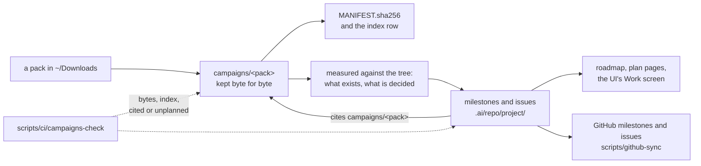

# Working from the owner's packs

A prompt pack is a brief the owner handed over: what was wanted, on a date, in an order. The
repository keeps every pack byte for byte under `campaigns/`, and it does not execute them.
What a pack asked for becomes the repository's own plan — milestones and issues under
`.ai/repo/project/` — and the plan is what a worker starts from. This page says how the two
are connected and where to begin.

## For whom

- **A worker picking up work.** Start from an issue, not from a pack. The issue says what was
  measured, what to change and how it is decided; the pack is where to read why it was asked.
- **The owner.** Each pack below names the milestones and issues that came of it, and what in
  it was not planned because the repository already has it or has decided otherwise.
- **A reviewer.** A record cites its pack by path, so the brief behind a change can be opened.

## How a pack becomes work



1. **Kept.** The pack directory is copied in unmodified; `campaigns/MANIFEST.sha256` records
   its bytes and `campaigns/README.md` its row.
2. **Measured.** Before anything is planned, each thing the pack asks for is checked against
   the tree. Much of it usually exists already, and some of it contradicts a decision the
   repository has made. Neither becomes an issue.
3. **Planned.** What remains is written as issues of about one pull request each, grouped
   under milestones. Every record cites the pack file it came from in its `why` or `problem`.
4. **Projected.** The roadmap, the plan pages of the site, `docs/PLAN_STATUS.md` and the UI
   are derived from the records. GitHub receives them when `scripts/github-sync --apply` is
   run on the trunk.
5. **Held.** `scripts/ci/campaigns-check` fails when a record cites a pack that is not kept,
   and when a pack is neither cited by a record nor named in
   `.ai/repo/ci/campaigns-unplanned.txt` with the reason.

## The packs of 2026-10-11 and 2026-10-12

| pack | milestones | issues | start with |
|---|---|---|---|
| `campaigns/majordomus-incremental-derive-prompt-pack` | `a-derive-does-only-the-work-its-inputs-changed`, `a-derivation-computed-once-is-reused` | I2521-I2533 | I2521: measure what a derive costs per stage |
| `campaigns/majordomus-intent-ui-pack` | `the-ui-starts-work-through-the-executor`, `an-intent-is-carried-from-a-sentence-to-a-verdict` | I2536-I2545 | I2536, I2538, I2541-I2544: none depends on another |
| `campaigns/majordomus-autonomous-idd-maximal` | `started-work-is-explained-bounded-and-survives-a-restart`, `an-intent-is-followed-to-the-deployment-that-carries-it` | I2502, I2503, I2505-I2508, I2511 | I2502: say which ready issue may start, and why |
| `campaigns/majordomus-shellfall` | `automation-is-scripted-capabilities`, `shell-shrinks-to-its-bootstrap` | I2549-I2561 | I2549: put ADR 0069 on the trunk; I2550: the baseline |
| `campaigns/majordomus-ui-speed-pack` | `a-screen-is-fast-bounded-and-says-why` | I2563-I2570 | I2564, I2565, I2566, I2568 |
| `campaigns/majordomus-profile-system-v2-prompt-pack` | `a-profile-is-resolved-once-and-enforced` | I2573-I2584 | I2573: trace a profile from its file to finish |
| `campaigns/majordomus-convergence-pack-20261012` | none: it is the running campaign `majordomus-autonomous-convergence` | none | the campaign's coordinator |

The numbers that are missing from a range were
taken and released: two packs asked for the same thing, and it is planned once.

## What was not planned, and why

Each pack was read as a brief, and a brief can ask for what the repository has decided
against. These are recorded so that nobody plans them again by accident.

| the pack asks for | the repository's decision | so |
|---|---|---|
| a UI that changes things itself (an "action plane") | a screen reads and never executes (ADR 0142) | the UI posts a form to the executor's own route (I2537) |
| executions with queues, retries, pause and a scheduler | an execution is a watched capability call (ADR 0033) | a journal across a restart (I2503) and a read-only explanation of what may start (I2502) |
| the tool proposing criteria and plans by itself | the tool does not reason; a worker writes records and capabilities validate them (ADR 0144) | writers that accept only what the caller supplies (I2542, I2543) |
| stored intent stages | no status is stored; a stage is derived (ADR 0070) | nothing |
| merge, release and deploy buttons | the lane executor merges, one pull request at a time (ADR 0101) | nothing |
| page and fragment caches | a cache is invisible; readings are kept, pages are not (ADR 0142) | conditional requests from a screen's readings (I2563) |
| a workflow engine with its own nouns | a capability may be scripted, and nothing else is added (ADR 0069) | the scripted-capability kind (I2552) |
| every recipe generated, shell removed at once | the shell half is what the installer ships and what the hooks run | an ordered migration with a count that cannot rise (I2550, I2556, I2560) |
| peer scheduling and provider-side enforcement of a profile | the tool starts no worker and invokes no model (ADR 0032, ADR 0044) | one refusal at the capability executor (I2579) |

## Starting

```bash
majordomus plan next
majordomus plan validate
```

`plan next` lists the issues whose dependencies are satisfied; `plan validate` checks the
graph. An issue's record is `.ai/repo/project/issues/<id>.yaml`: read its `current_state`
before touching code, because it says what was measured on 2026-10-13 and the tree moves.
Work under a task whose scope is the issue's `scope`, claim the paths on the board before
building, and allocate ADR and case numbers from the allocators; no record here reserves one.

Three records should be read before the issues that lean on them:

- **I2486** has no completion stamp although its code is on the trunk. Four issues of the UI
  speed milestone depend on it and stay blocked until its record is stamped.
- **I0201-I0206** (`runtime-adapters`) overlap the profile resolver of I2575. Read both
  before starting either.
- **I1900-I1903 and I2000-I2004** carry no completion stamp although the capabilities they
  describe exist. Their state should be settled before the intent milestones build on them.

## Adding the next pack

Copy it in as `campaigns/README.md` says, regenerate the manifest, add its row. Then plan it:
measure each ask, write the records with their citations, add the planning row, and run the
gate. A pack that is executed directly, with no records, is named in
`.ai/repo/ci/campaigns-unplanned.txt` with that reason.

## Where it is

| what | where |
|---|---|
| the packs, their index and their bytes | `campaigns/`, `campaigns/README.md`, `campaigns/MANIFEST.sha256` |
| the plan | `.ai/repo/project/milestones/`, `.ai/repo/project/issues/` |
| packs with no plan records, and why | `.ai/repo/ci/campaigns-unplanned.txt` |
| the gate | `scripts/ci/campaigns-check`, `test/cases/340_a_brief_is_kept_as_received.sh` |
| the projection to GitHub | `scripts/github-sync`, `scripts/ci/github-check` |
| the rule | `.ai/repo/rules/project/a-brief-is-kept-as-received.v1.md` |
